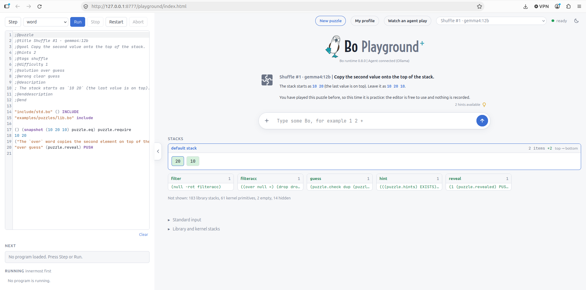

# Bo (BoLang)


Bo is the successor of Breeze [^1] (**Bo** means **B**reeze **o**ptimized), following a theoretical exercise in language minimalism: a **concatenative, purely postfix, homoiconic, stack-based** language with **no distinction between data and code**, and **no distinction between stacks and dictionary**. Runtime values are numbers, nested lists and named stacks (in the following, also referred to as words for convenience).

> [!IMPORTANT]
> Status: **experimental, draft specification**

A Bo program looks like this:

```clojure
;factorial.bo
;recursion: a definition that calls itself by name

"include/stack.bo" require
"include/io.bo" require

;local (private) definition for factorial
    (
    ; if n == 0
        (
        dup                 ; ( n -- n n )
        0 =                 ; ( n n -- n 0|1 )
        ) 
    ; then 1
        (drop 1)            ; ( n 0|1 -- 1 )
    ; else n * fact(n-1)
        (
        dup                 ; ( n 0|1 -- n n )
        1 -                 ; ( n n -- n n-1 )
        __fact        
        *                   ; ( n n-1 n-2 ... 1 -- n! )
        ) 
    ifte
    )
    (__fact)
PUSH

;public interface for factorial
    (__fact)
    (!)
PUSH

15 (x) PUSH     ; push data in the x stack

x !             ; top 15 from stack x on the default stack and execute code in !
ps              ; print default stack --> 0: 1307674368000

```

The [documentation](doc/README.md) includes the language guide, kernel
reference, library reference, and examples. 

The [VS Code extension](vscode/README.md)
provides editor support for Bo. The [WebAssembly](wasm/README.md) runtime is used for the browser [Playground](playground/README.md) and [Playground+](playground-plus/README.md), the local application where AI agents write puzzles, you play them and can watch a model play.

## Where to start

If Bo is new to you, start with the [beginner tutorial](doc/tutorial.md). It
takes a small program from a first stack operation through definitions,
quotations and named stacks, with examples that can be run in the terminal or
the playground. Then use the [language](doc/language.md) guide and the
[primitive](doc/primitives.md) and [library](doc/library.md) references as
needed.

Bo is ready for public experimentation, not for a compatibility or
general-purpose-language promise. Before 1.0, syntax and semantics may change
between minor releases; the [status and limitations](doc/status.md) page
describes that contract, the known constraints, and the relationship between
the Python, C and WebAssembly runtimes.

> [!TIP] 
> Want a quick look without installing anything? Try the [Bo playground](https://bolanguage.github.io/bo/) now in your browser.

To run Bo locally, clone the repository, build, and start the REPL. The full
build requires `cc`, `python3`, Git, Node.js 22.13 or later, npm and uv. Its
first run installs project dependencies and, if needed, Emscripten into
`~/emsdk`; these downloads can be large. For the C runtime alone, `make c`
requires only `cc` and `python3`.

```sh
git clone https://github.com/BoLanguage/bo.git
cd bo
make all                  # installs missing dependencies and builds all components
c/bo                      # REPL with the core words; try: "include/std.bo" require 1 2 + ps
c/bo examples/01-classics.bo   # run a program
```

After `make all`, exit the REPL and run Bo Playground+ (PG+) locally:

```sh
make playground-plus      # automatically opens PG+ in the browser
```

As an illustration, the following screenshot shows the playground with a puzzle generated by `gemma4:12b` (via Ollama):



See below for the other components and options.


## Building, running and testing

- Everything at once: `make all` checks and installs the project dependencies (a `.venv` with the `jupyter` extra via uv, and the npm packages for the playground, Playground+, JupyterLab and VS Code), installs Emscripten into `~/emsdk` if it is not already available, and builds the generated files, C and WebAssembly runtimes, playground editor bundle, JupyterLab extension and VS Code extension package `vscode/bolang-<VERSION>.vsix` (install it manually, for example with `code --install-extension`). It requires `cc`, `python3`, Git, Node.js 22.13 or later, npm and uv; missing system tools must be installed separately. The first run may download substantial dependencies. Use `make deps` to check and install project dependencies without building, or `make c` for the lightweight C-only build. `make check` verifies the generated files, `make test` builds and runs every test suite, and `make help` lists the individual targets.
- Build the C runtime: `make -C c` (produces `c/bo`).
- WebAssembly (experimental): with [Emscripten](https://emscripten.org) active (`source ~/emsdk/emsdk_env.sh`), `make -C c wasm` builds `wasm/build/bo-core.mjs` and `.wasm`; [wasm/bo.mjs](wasm/bo.mjs) wraps them (`createBo`, `eval`, `include`, stdin/stdout hooks) and `node wasm/test_examples.mjs` runs the examples and `node wasm/test_parallel.mjs` compares `PARALLEL` with the native runtime. Without `fork`, WASM workers run one after another in the same process on saved machine state (stacks created by a worker remain, empty), and `exit` stops only the current evaluation (`exitCode()`). The build also has a step debugger and state inspection for a visualizer (`bo.debug.load/step/run/abort`, `bo.state()`, `bo.stacks(filter)`, `bo.stack(name)`; see the comments in [wasm/bo.mjs](wasm/bo.mjs)): stacks defined after the library baseline (`markBaseline()`, done automatically after the autoload) are "user" stacks, while library, kernel and empty stacks are only counted until requested. Tests: `node web/test_debugger.mjs` (also run by `tests/test_wasm.py`).
- Playground (experimental): an editor, step debugger and stack visualizer in the browser, built on the WebAssembly runtime; `make playground` serves it and opens it in a browser (`PORT=n`, `OPEN=0`); see [playground/README.md](playground/README.md).
- Playground+ (experimental): after `make all`, `make playground-plus` serves the playground on `http://127.0.0.1:8777/`, opens it in a browser (`PORT=n`, `OPEN=0`) and prints the MCP configuration for an AI assistant; `make test-playground-plus` runs its tests. Its data is kept in `playground-plus/data/` (git-ignored). An MCP server (`playground-plus/mcp.mjs`) lets an LLM agent write puzzles for the player; with [Ollama](https://ollama.com) installed and a tool-capable model pulled (for example `ollama pull gemma4:12b`) the "New puzzle" button writes one with a local model, with no chat client needed. `node playground-plus/validate.mjs FILE...` checks puzzle files. See [playground-plus/README.md](playground-plus/README.md), which also shows how to connect an MCP client.
- Run: `c/bo file.bo ...`, `c/bo -e CODE` (run a code string at top level, like `python -c`; repeatable and mixable with files), or `c/bo` alone for a REPL (on a terminal it has line editing: arrows, Home/End, Delete, Ctrl-A/e/K/U/W, and up/down history; an `@` in a program pauses it there, and `c/bo --debug file.bo` stops at the file's first line; see [debugging](doc/debugging.md)). Both runtimes load the default-stack wrappers (`include/core.bo`) before the REPL, files, or C `-e` code; `--bare` starts with the kernel primitives only. The library is found next to the executable (`c/bo`) or the Python package, or in the directory named by `BO_HOME`, so a relative path such as `include/std.bo` works from any directory (it is looked up next to the including file, then in the current directory, then there). Load the standard library with `"include/std.bo" require` (on a `--bare` machine load `include/core.bo` first, with `() INCLUDE`, since `require` is defined there). An unknown `--option` is an error. C `--dump FILE` writes the final data stack to FILE (used by the differential test).
- Version: `c/bo --version` or `.venv/bin/python -m python.bo --version`. The version is in the `VERSION` file (`NUMBER DATE`), changes are listed in `CHANGELOG.md`, and each release is a git tag `vX.Y.Z`. To release, list the changes under `## Unreleased` in `CHANGELOG.md`, commit them, and run `make release VERSION=X.Y.Z` (optionally `SUMMARY="title"`, `DATE=YYYY-MM-DD`, `SKIP_TESTS=1` to run only `make check`, or `ALLOW_DIRTY=1` to put uncommitted changes in the release commit). It dates the changelog section, updates `VERSION`, runs `make generate` (which copies the version into the VS Code and JupyterLab `package.json` files), `make check` and `make test`, then makes one commit `Release X.Y.Z` and the tag `vX.Y.Z`. If anything fails, `VERSION` and `CHANGELOG.md` are restored. Nothing is pushed: the last line printed is the `git push` command.
- Python reference: `.venv/bin/python -m python.bo` (REPL with highlighting), or `.venv/bin/python -m python.bo file.bo`.
- Unit tests: `.venv/bin/python -m unittest discover tests` (includes the examples and documentation freshness checks).
- Differential test C vs Python: `make -C c test` (or `.venv/bin/python -m tests.diff_c`).
- Benchmarks (Python): `.venv/bin/python -m bench.bench`; comparison with other languages: see [benchmarks](doc/benchmarks.md).
- Documentation: `python3 tools/bodoc.py` regenerates the primitive inventory in `doc/primitives.md` and the adapter/library inventory in `doc/library.md`; `--check` only reports staleness. Primitive descriptions and effects live in `include/primitives.json`, while derived-word comments live in the focused `include/` modules.
- Jupyter: install the `jupyter` extra of `pyproject.toml` with uv (`make deps`), register the kernel with `.venv/bin/python -m python.bo.jupyter --install --user`, and install the local JupyterLab highlighter; see [the notebook guide](doc/notebook.md).

## Repository layout

- `python/bo/`: Python reference implementation (also the Jupyter kernel)
- `include/`: modular standard-library sources, `std.bo` aggregate, and `primitives.json` (the primitive inventory the generated files come from)
- `c/`: C runtime (operation compiler, interpreter, memory manager; also built to WebAssembly)
- `wasm/`: the WebAssembly runtime's JavaScript wrapper (`bo.mjs`), its build output (`wasm/build`, git-ignored) and its tests
- `playground/`: browser playground
- `playground-plus/`: Playground+, the local application built on the playground
- `doc/`: documentation
- `examples/`: example programs with expected output (and reference notebooks)
- `tests/`: unit, example and differential tests
- `bench/`: benchmarks
- `tools/`: generators for the adapters, documentation and syntax data
- `vscode/`: VS Code extension
- `jupyterlab/`: JupyterLab syntax-highlighting extension
- `images/`: the mascot and playground screenshots


## Mascot

Bo's mascot is [Bobo](doc/mascot.md) (top right). 


## AI assistance disclosure

The core design, architecture, and implementation of the language (building on the original Breeze [^1] released in 2015) are written by the author. AI coding assistants (such as GitHub Copilot) were used during the update process to help write unit tests, fix bugs, maintain repository organization, and refine documentation. All AI-assisted changes have been manually reviewed and tested, and the entire codebase remains released under the MIT License.

> [!NOTE]
> Contributors are welcome to use AI tools as well, provided that all submitted code is thoroughly understood, manually verified, and adheres to the project's architecture and test suite.


## References

- Concatenative languages: https://concatenative.org/


[^1]: Original Breeze resources: https://sourceforge.net/projects/breeze-language/ (project on SourceForge), https://breeze-language.sourceforge.net/ (documentation), https://concatenative.org/wiki/view/Breeze (language entry on Concatenative.org).


